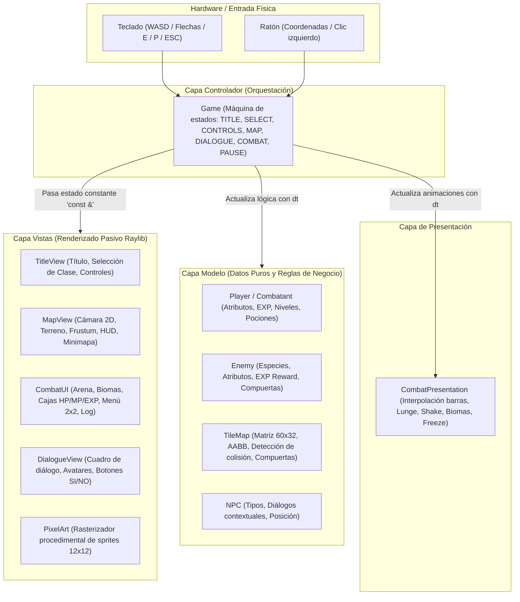

# INFORME TÉCNICO DE EVOLUCIÓN: MINI AVENTURA RPG V2

**Curso:** Programación de Videojuegos con C++  
**Plataforma:** Windows 10 / 11 (x64)  
**Lenguaje y Estándar:** C++20 (`stdcpp20`)  
**Biblioteca Multimedia:** Raylib 5.5.0 (vía NuGet estático)  
**Entorno de Desarrollo:** Visual Studio 2022 / MSVC Toolset v145 / MSBuild  
**Rama de Trabajo:** `mejora-v2`  
**Autor:** Xavier Estéfano Vásquez Yataco (U24237289)  

---

## 1. RESUMEN EJECUTIVO

El presente informe documenta la evolución integral de **Mini Aventura RPG** desde su prototipo base (v1) hacia la versión 2 (v2). El proyecto fue reestructurado de manera incremental y modular para satisfacer los estándares de calidad de software requeridos en el ámbito universitario.

La versión 2 transforma un prototipo monolítico y acoplado en un videojuego modular fundamentado en una **arquitectura MVC práctica**, con selección de tres clases tácticas de héroe, un mundo ampliado de 60x32 tiles con cámara 2D y minimapa, personajes no jugadores con diálogos reactivos, un sistema matemático de progresión de experiencia acumulativa, combate por turnos con efectos visuales dinámicos y persistencia de recursos en memoria durante la partida.

---

## 2. MATRIZ COMPARATIVA: PROTOTIPO V1 VS. VERSIÓN 2

| Dimensión | Prototipo Base (v1) | Versión 2 Mejorada (v2) | Beneficio Académico y Técnico |
| :--- | :--- | :--- | :--- |
| **Arquitectura de Software** | Lógica y hardware fuertemente acoplados: `Player` leía teclado directamente (`IsKeyDown`); las vistas capturaban coordenadas de ratón durante el renderizado. | **MVC Práctico y Desacoplado:** Modelos puros ([`Player`](Project1/Player.h), [`TileMap`](Project1/TileMap.h), [`NPC`](Project1/NPC.h)); Vistas pasivas ([`MapView`](Project1/MapView.h), [`CombatUI`](Project1/CombatUI.h), [`TitleView`](Project1/TitleView.h)); Controlador orquestador ([`Game`](Project1/Game.h)). | Separación clara de responsabilidades, alta legibilidad y mantenibilidad. |
| **Inicio y Selección de Héroe** | Inicio instantáneo en el mapa con un único personaje genérico de estadísticas invariables. | **Pantalla de Título y 3 Arquetipos:** Guerrero (tanque físico), Maga (alto daño arcano y maná) y Exploradora (mayor velocidad y huida táctica). | Profundidad de diseño lúdico y rejugabilidad mediante identidades marcadas. |
| **Escala de Mundo y Cámara** | Cuadrícula de 30x20 tiles estática; sin scroll, sin cámara y sin referencias espaciales. | **Mundo de 60x32 tiles (1920x1024 px) con `Camera2D`:** Seguimiento centrado con restricción de márgenes (*clamping*) y minimapa contextual con frustum visible. | Sensación de mundo abierto continuo, exploración guiada y orientación espacial. |
| **Narrativa e Interacción** | Cero personajes no jugadores (NPCs); mundo poblado únicamente por enemigos agresivos. | **Sistema de NPCs y Carteles:** Mentor Eldrin (consejo progresivo), Guardia Rurik, Explorador Varek, Curandera Elena (`[S]/[N]`) y 5 carteles informativos. | Inmersión narrativa y asistencia al jugador sin implementar sistemas complejos de misiones. |
| **Progresión del Héroe** | Subida automática y fija de exactamente 1 nivel tras cada combate individual. | **Experiencia (EXP) Acumulativa:** Curva de nivel $\text{expNext} = \text{nivel} \times 50$; enemigos con recompensas escaladas; admite subidas de múltiples niveles continuos. | Crecimiento orgánico del personaje proporcional al reto asumido. |
| **Persistencia de Recursos** | Curación total automática al salir de cualquier combate; pociones sin lógica de exceso. | **Persistencia en Memoria:** Salud y maná se conservan entre batallas; la subida de nivel no cura mágicamente; Elena sana y aplica regla anti-acumulación de pociones. | Introduce administración estratégica de recursos y valorización de las pociones. |
| **Sensación de Combate (*Game Feel*)** | Interfaz estática sin animaciones ni respuesta al daño; actualización instantánea de barras. | **Módulo [`CombatPresentation`](Project1/CombatPresentation.h):** Barras interpoladas con `dt`, embestida (*lunge*), destello de impacto (*hit flash*), sacudida (*shake*) y 3 biomas adaptativos. | Retroalimentación visual tangible que enriquece la experiencia del usuario sin acoplar el modelo. |
| **Calidad de Compilación** | Advertencia C4244 activa en `MapView.cpp`. | **0 Errores de compilación:** Compilación limpia con `/W3` y `/permissive-` en `Debug|x64` y `Release|x64`. | Estabilidad profesional de compilación sobre Visual Studio 2022. |

---

## 3. ARQUITECTURA REAL DEL SISTEMA (MVC PRÁCTICO)

### 3.1. Justificación del Patrón Adoptado
El sistema no se categoriza como un "MVC puro académico", sino como un **MVC práctico para videojuegos en tiempo real**:
* **El Modelo** es totalmente agnóstico de Raylib: almacena datos y lógica matemática (fórmulas de daño, cálculo de EXP, colisiones AABB).
* **Las Vistas** son pasivas y deterministas: reciben referencias constantes (`const &`) de los datos a dibujar y exponen funciones de consulta puramente geométricas (`GetHoveredButton`, `GetChoiceButtonRect`), sin leer hardware.
* **El Controlador ([`Game`](Project1/Game.h))** orquesta el bucle de juego: lee el hardware (teclado y ratón de Raylib), consulta las coordenadas geométricas a las vistas, muta el modelo según las acciones del usuario, y actualiza los temporizadores de animación en [`CombatPresentation`](Project1/CombatPresentation.h).

### 3.2. Diagrama de Relación y Flujo de Datos



---

## 4. DESGLOSE TÉCNICO DE MÓDULOS IMPLEMENTADOS

### 4.1. Módulos del Modelo (`Model`)
* **[`Player.h`](Project1/Player.h) / [`Player.cpp`](Project1/Player.cpp):**
  * Define la clase base `Combatant` y las derivadas `Player` y `Enemy`.
  * Encapsula los atributos: `hp`, `maxHp`, `mp`, `maxMp`, `atk`, `def`, `level`, `exp`, `expNext`, `potions`.
  * Métodos de combate: `TakeDamage()`, `UsePotion()`, `GainExp()`.
  * La ganancia de experiencia aplica la regla de nivelación progresiva con bucle `while (exp >= expNext)`, permitiendo escalonamiento de múltiples niveles si la recompensa supera varios umbrales consecutivos.
* **[`TileMap.h`](Project1/TileMap.h) / [`TileMap.cpp`](Project1/TileMap.cpp):**
  * Almacena la matriz estática de 60 columnas por 32 filas (`MAP_WIDTH = 60`, `MAP_HEIGHT = 32`).
  * Administra el estado de dos compuertas bloqueantes (`gate1Open`, `gate2Open`).
  * Implementa colisiones AABB con soporte para deslizamiento fluido en paredes mediante pruebas ortogonales independientes en los ejes X e Y.
* **[`NPC.h`](Project1/NPC.h) / [`NPC.cpp`](Project1/NPC.cpp):**
  * Estructura liviana que define identificador, posición en mundo, tipo de interacción (`DIALOGUE`, `HEALER`, `SIGN`) y diálogo dinámico basado en el estado del juego.

### 4.2. Módulos de Vistas (`Views`)
* **[`TitleView.h`](Project1/TitleView.h) / [`TitleView.cpp`](Project1/TitleView.cpp):**
  * Dibuja el fondo azul noche con destellos dorados, la pantalla de controles y el menú de selección de héroe con tarjetas estadísticas detalladas.
  * Mantiene la opción "Continuar" deshabilitada mostrando el estado real: `"(Disponible al implementar guardado)"`.
* **[`MapView.h`](Project1/MapView.h) / [`MapView.cpp`](Project1/MapView.cpp):**
  * Maneja el objeto `Camera2D` de Raylib centrando la vista en el héroe con *clamping* en los límites `[0, 1920 - 960]` y `[0, 1024 - 540]`.
  * Renderiza los cuatro sectores, los tiles decorativos, los enemigos en el mapa, los NPCs y el minimapa en la esquina superior derecha con el marco de cámara visible.
* **[`CombatUI.h`](Project1/CombatUI.h) / [`CombatUI.cpp`](Project1/CombatUI.cpp):**
  * Dibuja la cuadrícula de batalla con resolución 960x540: panel de enemigo, panel de héroe, caja de texto de acciones y cuadrícula 2x2 para Atacar, Habilidad, Poción y Huir.
* **[`CombatPresentation.h`](Project1/CombatPresentation.h) / [`CombatPresentation.cpp`](Project1/CombatPresentation.cpp):**
  * Interpola suavemente las barras de vida y maná (`displayHeroHp`, `displayHeroMp`, `displayEnemyHp`).
  * Genera el efecto de embestida (*lunge*) mediante función sinusoidal dependiente del tiempo restante.
  * Produce destellos cromáticos de impacto y sacudida de pantalla con decaimiento lineal.
  * Congela los temporizadores durante la pausa para evitar artefactos visuales.
* **[`DialogueView.h`](Project1/DialogueView.h) / [`DialogueView.cpp`](Project1/DialogueView.cpp):**
  * Cuadro de diálogo inferior con tipografía nítida y botones interactivos de decisión `[S] SÍ` / `[N] NO` para la curandera Elena.
* **[`PixelArt.h`](Project1/PixelArt.h) / [`PixelArt.cpp`](Project1/PixelArt.cpp):**
  * Rasteriza proceduralmente avatares y sprites de 12x12 píxeles para héroes, enemigos y NPCs, eliminando dependencias de archivos de imagen externos.

### 4.3. Módulo Controlador (`Controller`)
* **[`Game.h`](Project1/Game.h) / [`Game.cpp`](Project1/Game.cpp):**
  * Bucle principal a 60 FPS fijos.
  * Máquina de estados: `TITLE`, `HERO_SELECT`, `CONTROLS`, `MAP`, `DIALOGUE`, `COMBAT`, `PAUSE`, `GAME_OVER`, `VICTORY`.
  * Coordina el inicio de batalla al entrar en colisión con un enemigo en el mapa, transfiere datos entre módulos y aplica las reglas de fin de combate.

---

## 5. BALANCE DE JUEGO Y DISEÑO MATEMÁTICO

### 5.1. Estadísticas de los Tres Héroes
| Arquetipo | HP Base | DEF Base | ATK Base | MP Base | Habilidad Especial | Coste MP | Mult. Daño | Tasa Huida | Velocidad |
| :--- | :---: | :---: | :---: | :---: | :--- | :---: | :---: | :---: | :---: |
| **Guerrero** | 120 | 6 | 18 | 15 | Golpe Fuerte | 10 | x2.0 | 50% | 1.00x |
| **Maga** | 80 | 2 | 14 | 40 | Centella Arcana | 12 | x2.6 | 50% | 1.00x |
| **Exploradora** | 100 | 4 | 16 | 25 | Tiro Crítico | 10 | x2.2 | 65% | 1.15x |

### 5.2. Estadísticas de Enemigos y Recompensas de Experiencia
| Especie | Sector del Mapa | Rol | HP | ATK | DEF | Recompensa EXP | Efecto al Vencer |
| :--- | :--- | :--- | :---: | :---: | :---: | :---: | :--- |
| **Slime** | Pradera | Enemigo común | 35 | 10 | 2 | 25 | Monstruo derrotado |
| **Murciélago Guardián** | Pradera / Umbral | **Guardián 1** | 70 | 14 | 4 | 50 | **Abre Compuerta 1 (Bosque)** |
| **Goblin** | Bosque | Enemigo común | 60 | 15 | 4 | 60 | Monstruo derrotado |
| **Lobo Guardián** | Bosque / Umbral | **Guardián 2** | 110 | 20 | 6 | 90 | **Abre Compuerta 2 (Ruinas)** |
| **Esqueleto** | Ruinas | Enemigo élite | 90 | 22 | 8 | 110 | Monstruo derrotado |
| **Dragón** | Ruinas Profundas | **Jefe Final** | 220 | 30 | 12 | 300 | **Activa Estado de Victoria** |

### 5.3. Modelo Matemático de Nivelación
* Umbral de experiencia para alcanzar el siguiente nivel:
  $$\text{expNext}(L) = L \times 50$$
  * Nivel 1 $\to$ 2: Requiere 50 EXP.
  * Nivel 2 $\to$ 3: Requiere 100 EXP adicionales acumuladas en el nivel.
  * Nivel 3 $\to$ 4: Requiere 150 EXP adicionales.
* La implementación en [`Player::GainExp()`](Project1/Player.cpp) procesa un bucle `while`:
  ```cpp
  exp += amount;
  while (exp >= expNext) {
      exp -= expNext;
      level++;
      ApplyStatGrowth();
      expNext = level * 50;
  }
  ```
  Esto garantiza matemáticamente que vencer a un enemigo de alta recompensa (por ejemplo, el Dragón con 300 EXP) procese automáticamente dos o más subidas de nivel sin pérdida de experiencia residual.

---

## 6. ESTADO DE PERSISTENCIA Y ALCANCE PENDIENTE (ETAPA 7)

Para mantener total transparencia técnica y académica:
* **Persistencia en Memoria (Implementada):** Durante la partida activa, los valores de HP, MP, nivel, experiencia, pociones y estado de las compuertas se mantienen intactos entre batallas y exploración.
* **Persistencia en Disco (Alcance Futuro - Etapa 7 Pendiente):**
  * La serialización de la partida en archivo físico (`savegame.txt`) no forma parte del código compilado en la rama `mejora-v2`.
  * La opción "Continuar" del menú principal permanece desactivada de forma deliberada informando al usuario de esta condición.
  * Las pruebas de estrés de guardado y validación de archivos corruptos se documentan en el plan de pruebas como especificación de verificación para cuando dicho módulo sea integrado.

---

## 7. CONCLUSIÓN TÉCNICA

Mini Aventura RPG v2 cumple satisfactoriamente con los objetivos formativos y funcionales de las etapas 1 a 6. El código es robusto, modular, compila limpiamente en Visual Studio 2022 sin advertencias de nivel `/W3`, y ofrece una experiencia de juego balanceada, atractiva e intuitiva.
